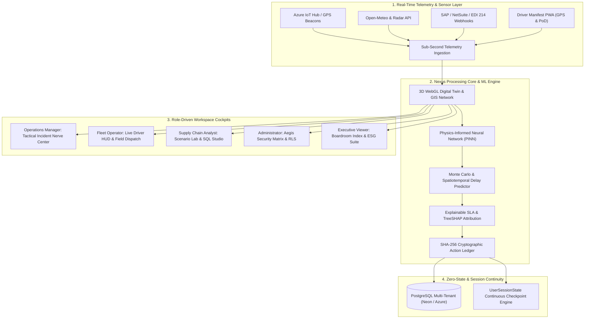

<div align="center">

# 🌐 NEXUS
### *Autonomous Logistics Operating System & Real-Time Digital Twin*

[-000000?style=for-the-badge&logo=nextdotjs&logoColor=white)](https://nextjs.org/)
[](https://fastapi.tiangolo.com/)
[](https://www.postgresql.org/)
[](https://leafletjs.com/)
[](https://www.typescriptlang.org/)
[](https://tailwindcss.com/)
[](LICENSE)

<br />

**[🚀 Live Production Web App](https://nexus-logistics-os.vercel.app)** · **[🌐 System Status & SLA](https://nexus-logistics-os.vercel.app/status)** · **[📖 Architecture Blueprint](docs/ROLE_DRIVEN_ARCHITECTURE_BLUEPRINT.md)** · **[⚡ API Docs (Swagger)](https://nexus-api-prod-adfjh5fvabd6cpgv.austriaeast-01.azurewebsites.net/docs)** · **[☁️ Azure Roadmap](docs/AZURE_ENTERPRISE_INTEGRATIONS_ROADMAP.md)** · **[🚀 Deployment Playbook](docs/DEPLOYMENT.md)**

</div>

---

## ⚡ Executive Overview

Traditional logistics and fleet visibility platforms (e.g. Samsara, Project44, Flexport, Manhattan TMS) are **passive monitoring dashboards** — they notify teams *after* a driver is stuck in a blizzard or after an SLA breach has occurred, leaving operators to manually scramble across phone calls and spreadsheets.

**NEXUS is an Autonomous Logistics Operating System with a Real-Time Spatial Digital Twin and a Predictive Monte Carlo & Physics-Informed ML Decision Engine.**

Instead of reactive alerts, NEXUS **preempts disruptions before they happen**, continuously simulating dynamic weather hazards, fuel spikes, telemetry drift, and depot chokepoints, then generating one-click cryptographic rerouting actions and zero-install mobile driver passes.

```
┌─────────────────────────────────────────────────────────────────────────────────────────┐
│                              THE NEXUS PARADIGM SHIFT                                   │
├────────────────────────────┬────────────────────────────────────────────────────────────┤
│ Traditional Fleet Software │ NEXUS Autonomous Digital Twin                              │
├────────────────────────────┼────────────────────────────────────────────────────────────┤
│ ❌ Reactive alert pings    │ ✅ Predictive preemption (AI simulates bottlenecks ahead)  │
│ ❌ Monolithic single view  │ ✅ 5 bespoke role cockpits tailored to exact workflows     │
│ ❌ Clunky legacy UI        │ ✅ Apple-grade tactile design (iOS grouped hierarchy,     │
│                            │    SF typography, subtle haptics & audio cues)             │
│ ❌ Manual rerouting calls  │ ✅ 1-Click Monte Carlo AI simulation + auto-rerouting      │
│ ❌ Slow transactional DB   │ ✅ Role-partitioned PostgreSQL materialized query layers  │
│ ❌ App store friction      │ ✅ Zero-install mobile Driver PWA & QR Proof of Delivery   │
│ ❌ Hardcoded mock clutter  │ ✅ Clean zero-state by default + interactive sandbox mode  │
└────────────────────────────┴────────────────────────────────────────────────────────────┘
```

---

## 🏛️ System Architecture



---

## 👥 The 5 Role-Driven Cockpits

NEXUS discards the generic one-size-fits-all dashboard. Each organization role receives an entirely distinct, purpose-built cockpit designed for their cognitive load and responsibilities:

| Role Cockpit | Primary Objective | Key Widgets & Capabilities |
| :--- | :--- | :--- |
| **🚨 Operations Manager** | Clear chokepoints & minimize SLA penalties within 90s | • **SLA Breach Countdown Queue** ranked by liability ($\$$)<br />• **Split-Screen AI Resolver**: Baseline vs. Bypass delta<br />• **1-Click Reroute Authorization** dispatched to trucks |
| **🚚 Fleet Operator** | Driver shift safety & real-time dock turnarounds | • **High-Density Telemetry Stream** (Speed, Battery %, PSI, $-4.2^\circ\text{C}$ Temp)<br />• **Tactical Keyboard Hotkeys** (`[Space]` Acknowledge, `[D]` Dispatch)<br />• **1-Click Driver Voice Bridge** and SOS Emergency Broadcast |
| **🔬 Supply Chain Analyst** | Multi-variate what-if modeling & network economics | • **Monte Carlo Simulation Lab** ($1\text{k} - 10\text{k}$ stochastic runs)<br />• **Predictive Delay Distribution Histogram** & Risk confidence curve<br />• **Instant Dataset Export** to `.parquet`, `.csv`, and `.json` |
| **🛡️ System Administrator** | 99.99% uptime, data privacy & security governance | • **Data Pipeline Health Latency Monitor** (Azure IoT, Kafka, Redis)<br />• **Immutable Cryptographic Action Ledger** (SHA-256 hash chains)<br />• **FIDO2 / Passkey Hardware Enforcement** & Multi-tenant RLS |
| **📊 Executive Viewer** | Boardroom ROI visibility, margin preservation & ESG | • **Enterprise Macro KPI Suite** (Global OTD $98.4\%$, Net Savings $\$1.42\text{M}$)<br />• **Scope 1 & 3 ESG Carbon Avoidance Index** ($42.8\text{ Tons}$ avoided)<br />• **1-Click Executive PDF Briefing Generator** |

---

## 📱 Mobile Driver Portal & Proof of Delivery (PWA)

NEXUS features a dedicated zero-install driver experience accessible directly via QR code dispatch:
- **Instant Manifest Access**: Direct link without requiring app store installations (`/driver-pass` and `/driver`).
- **Live GPS Beaconing**: Sub-second location updates streamed directly to the central dispatch map.
- **Geo-Verified Proof of Delivery (PoD)**: Captures digital signatures, cargo verification photos, and timestamped coordinates.

---

## 🧠 Industry-Grade Machine Learning Subsystem

The NEXUS backend embeds an enterprise-grade AI engine (`backend/app/ml/`):
- **Physics-Informed Neural Networks (PINNs)**: Modeled kinematic degradation and telematics wear based on differential equations rather than naive heuristics.
- **Spatiotemporal Delay Predictor**: Multi-hop graph convolution and neural regression predicting delay variance across corridors.
- **Explainable SLA Breaches (TreeSHAP)**: Granular risk attribution identifying the exact factors driving delay probabilities.
- **Sub-Millisecond Lazy Loading**: High startup resilience engineered specifically for Azure App Service cloud deployments.

---

## 🛠️ Monorepo Structure

```
Nexus/
├── backend/                       # FastAPI High-Performance Backend
│   ├── app/
│   │   ├── api/v1/endpoints/      # REST Endpoints (Vehicles, Warehouses, ML, Driver)
│   │   ├── core/                  # Security, Passkeys, Rate Limiting & Config
│   │   ├── db/                    # Async SQLAlchemy & PostgreSQL Connection
│   │   ├── ml/                    # Physics-Informed ML, Spatiotemporal Models & SHAP
│   │   ├── models/                # Database ORM Entity Models
│   │   ├── services/              # AI Synthesis, ML Engine, Task Queues & Telemetry
│   │   └── voice/                 # WebRTC / Voice AI Streaming Copilot
│   └── tests/                     # 79+ Comprehensive Pytest Test Suites
│
├── frontend/                      # Next.js 15 App Router Frontend
│   ├── app/
│   │   ├── (app)/overview/        # Main Command Center (Mounts 5 Cockpits)
│   │   ├── (app)/operations/      # Fleet Vehicles, Warehouses & Orders with CSV Ingestion
│   │   ├── (app)/status/          # Live SLA Health & Uptime Dashboard
│   │   ├── (app)/admin/audit/     # Cryptographic SHA-256 Audit Trail Ledger
│   │   ├── (app)/settings/        # iOS-Grade Apple HIG Grouped Settings
│   │   ├── (app)/simulations/     # Monte Carlo Scenario Builder
│   │   └── driver-pass/           # Zero-Install Mobile Driver PWA & QR PoD
│   ├── components/
│   │   ├── role-dashboards/       # Manager, Operator, Analyst, Admin & Viewer
│   │   ├── forms/                 # CsvImportModal, CreateVehicle, CreateOrder
│   │   ├── map/                   # Interactive Leaflet World Map & Telemetry HUD
│   │   ├── ui/                    # Omnisearch Command Palette, SupportTicketModal
│   │   └── settings/              # AppleSettingsView Inset Hierarchy
│   ├── lib/                       # CSV Export, Sound Effects Synthesizer, RBAC
│   └── styles/                    # Tailwind CSS Design Tokens & SF Typography
│
├── database/                      # Prisma Schema & Database Migrations
│   └── prisma/schema.prisma       # Multi-tenant RLS & Telemetry Stream Models
│
└── docs/                          # Comprehensive Technical Documentation
    ├── ROLE_DRIVEN_ARCHITECTURE_BLUEPRINT.md
    ├── AZURE_ENTERPRISE_INTEGRATIONS_ROADMAP.md
    ├── INDUSTRY_LEVEL_ML_ARCHITECTURE.md
    ├── ARCHITECTURE.md
    ├── DEPLOYMENT.md
    └── API_SPECIFICATION.md
```

---

## 🚀 Quickstart & Local Development

### Prerequisites
- **Node.js**: `v20.x` or higher
- **Python**: `v3.11` or higher
- **PostgreSQL**: Local instance or Neon Cloud connection URL

### 1. Repository Setup
```bash
git clone https://github.com/AadityaUniyal/Nexus.git
cd Nexus
```

### 2. Frontend Development (Next.js 15)
```bash
cd frontend
npm install
npm run dev
# Open http://localhost:3000 in your browser
```

### 3. Backend Development (FastAPI)
```bash
cd backend
python -m venv venv

# Windows:
venv\Scripts\activate
# macOS/Linux:
source venv/bin/activate

pip install -r requirements.txt
uvicorn app.main:app --reload --port 8000
# API Docs available at http://localhost:8000/docs
```

### 4. Running Verification Test Suites
```bash
# Run backend test suite (79+ passing tests)
python -m pytest backend/tests

# Run frontend TypeScript type verification & lint
cd frontend
npm run typecheck
npm run lint
```

---

## 🔐 Security & Governance

- **Biometric & Passkey Enclave**: FIDO2 / WebAuthn passwordless authentication with hardware-bound credentials.
- **Multi-Tenant Isolation**: Enforced PostgreSQL Row-Level Security (RLS) on all `workspace_id` queries.
- **Cryptographic Action Ledger**: Every automated AI decision and human override is hashed with SHA-256 and chained into an immutable audit trail.
- **Rate-Limiting**: Sliding-window token governor protecting against brute-force and DDoS vectors.

---

## 📄 License

This project is licensed under the MIT License — see the [LICENSE](LICENSE) file for details.
