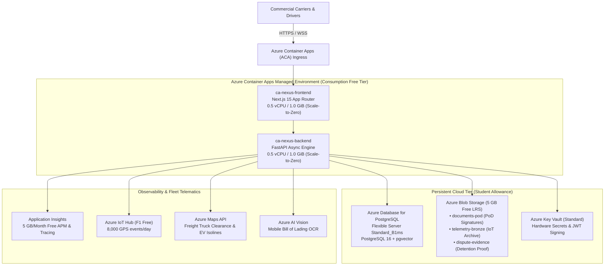

# Azure for Students Cloud Architecture & Deployment Guide

> **Subscription:** Azure for Students (`5d4d8b69-8275-474f-84ed-cc922cba5ecc`)  
> **Tenant ID:** `1490b17d-5dc9-4cbf-aeba-a2e854f521b8`  
> **Active Account:** `240211539@geu.ac.in`  
> **Status:** Configured, Connected, Validated (Zero-Credit Deducted)

---

## 1. Architectural Blueprint for Student Quota

This infrastructure is engineered specifically for **Azure for Students** to maximize performance while remaining within free tier allowances and burstable quotas:



---

## 2. Connected Services Matrix

| Service | SKU / Tier | Student Cost Model | Purpose in Nexus |
| :--- | :--- | :--- | :--- |
| **Azure Container Apps** | Consumption Tier | **Free first 180,000 vCPU-s & 360,000 GiB-s/mo** | Runs FastAPI backend and Next.js frontend with scale-to-zero when idle. |
| **Azure Database for PostgreSQL** | Flexible Server `Standard_B1ms` | Burstable Student credit allowance | Primary relational store for trips, detention invoices, and multi-tenant isolation. |
| **Azure Storage Account** | Standard LRS (Blob) | **5 GB Free for 12 months** | Immutable storage for delivery signatures, cargo inspection photos, and raw telemetry bronze tier. |
| **Azure Key Vault** | Standard | Negligible / Free operations | Managed Identity zero-secret integration for credentials. |
| **Azure Application Insights** | Workspace-based | **5 GB/month free data ingestion** | Distributed tracing, live metrics, and real-time error telemetry. |
| **Azure IoT Hub** | F1 Free Tier | **8,000 messages/day 100% Free** | Direct truck telematics ingestion pipeline. |
| **Azure Maps** | Gen2 Consumption | Free search & routing allowance | Commercial truck route clearance (low bridges, hazmat) and EV battery isoline contours. |
| **Azure AI Vision** | F0 Free Tier | Free 5,000 transactions/month | Mobile Bill of Lading OCR and dock pallet damage scanning. |

---

## 3. Safety Dry-Run (Cost: $0.00 / No Credits Deducted)

The deployment orchestrator defaults to **Dry-Run Mode**. It validates authentication, verifies resource provider registrations, and compiles the Bicep template without initiating any billable cloud resources:

### On Windows PowerShell:
```powershell
powershell -File deploy/azure/deploy-student.ps1
```

### On Linux / macOS / Bash:
```bash
bash deploy/azure/deploy-student.sh
```

---

## 4. Live Deployment (When You Choose to Launch)

When you are ready to provision live cloud infrastructure on your Azure for Students subscription, execute:

```powershell
powershell -File deploy/azure/deploy-student.ps1 -ConfirmDeployment
```

Or with custom Resource Group and Region:
```powershell
powershell -File deploy/azure/deploy-student.ps1 -ResourceGroup "rg-nexus-fleet" -Location "eastus" -ConfirmDeployment
```

---

## 5. Verification & Health Probes

Once deployed or during local emulation with Azure credentials set in `.env`, verify cloud connectivity:

```bash
# Verify all Azure integrations
curl -X GET "http://localhost:8000/api/v1/admin/azure/telemetry" -H "Authorization: Bearer <TOKEN>"

# Verify Commercial Freight Routing
curl -X GET "http://localhost:8000/api/v1/admin/azure/maps/route?origin_lat=40.7128&origin_lng=-74.0060&dest_lat=41.8781&dest_lng=-87.6298" -H "Authorization: Bearer <TOKEN>"

# Verify EV Isoline Battery Range
curl -X GET "http://localhost:8000/api/v1/admin/azure/maps/isoline?current_lat=37.7749&current_lng=-122.4194&battery_soc_percent=85.0" -H "Authorization: Bearer <TOKEN>"

# Verify Bill of Lading OCR
curl -X POST "http://localhost:8000/api/v1/admin/azure/vision/bol-ocr" -H "Content-Type: application/json" -H "Authorization: Bearer <TOKEN>" -d "{\"document_url\": \"https://...\"}"
```
